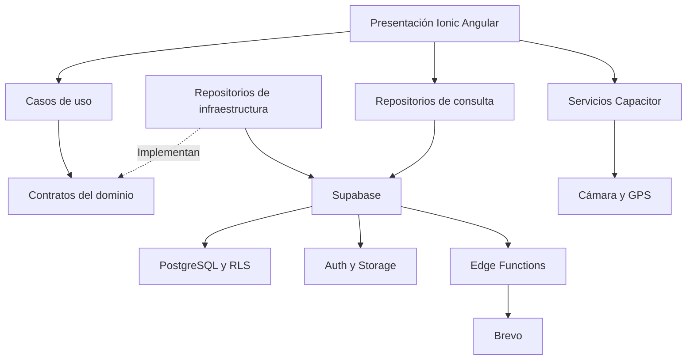
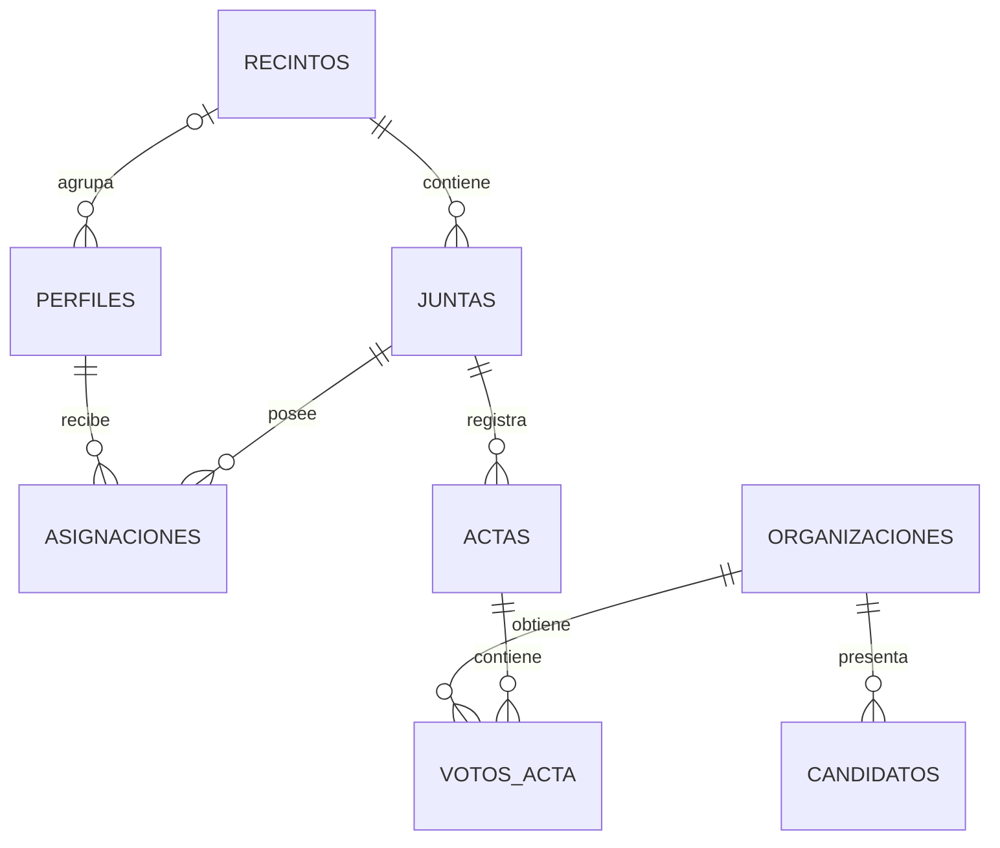

# Control Electoral

Sistema móvil para la gestión, registro y seguimiento de resultados electorales, desarrollado como parte del Examen 01 de Desarrollo de Aplicaciones Móviles.


## 1. Descripción

Control Electoral es una aplicación móvil que permite administrar recintos electorales, juntas receptoras del voto (JRV), usuarios y resultados de las elecciones de alcalde y prefecto.

El sistema establece una jerarquía de usuarios mediante tres perfiles: coordinador provincial, coordinador de recinto y veedor.

La aplicación permite registrar y corregir actas electorales, validar la consistencia de los votos, capturar evidencias fotográficas, comprobar la nitidez de las imágenes y registrar coordenadas geográficas.

La información se almacena de forma centralizada en Supabase, aplicando políticas de seguridad según el rol y las asignaciones de cada usuario.

## 2. Objetivo

Desarrollar una aplicación móvil que facilite el registro, control y seguimiento de resultados electorales mediante una arquitectura organizada, autenticación segura, validación de datos y utilización de recursos nativos del dispositivo móvil.

## 3. Funcionalidades

### 3.1. Autenticación

- Inicio de sesión mediante cédula y contraseña.
- Validación de cédula ecuatoriana en la creación de cuentas.
- Cambio obligatorio de contraseña en el primer acceso.
- Recuperación de contraseña mediante código enviado al correo electrónico.
- Envío de correo de bienvenida al crear usuarios.
- Protección de rutas según el rol.
- Cierre de sesión.

### 3.2. Coordinador provincial

- Consulta y creación de recintos electorales.
- Gestión de juntas receptoras del voto.
- Creación de coordinadores de recinto.
- Asignación de coordinadores a recintos.
- Gestión de organizaciones políticas y candidatos.
- Consulta del avance del registro electoral.
- Visualización de resultados consolidados y por recinto.
- Consulta de evidencias fotográficas y coordenadas GPS.

### 3.3. Coordinador de recinto

- Consulta de las juntas de su recinto.
- Creación de usuarios con rol de veedor.
- Asignación y reasignación de juntas.
- Seguimiento del estado de las actas electorales.
- Corrección de votos registrados.
- Corrección de evidencias fotográficas.
- Actualización de coordenadas geográficas.

### 3.4. Veedor

- Consulta exclusiva de las juntas asignadas.
- Registro de actas de alcalde y prefecto.
- Registro de votos por organización política.
- Registro de votos nulos y blancos.
- Validación del total de sufragantes.
- Corrección de actas.
- Captura de fotografías mediante la cámara del dispositivo.
- Validación automática de nitidez.
- Obtención de coordenadas GPS.
- Almacenamiento de evidencias electorales.

## 4. Tecnologías utilizadas

| Tecnología | Versión declarada | Propósito |
|---|---|---|
| Ionic Angular | 9.0.0 | Interfaz móvil |
| Angular | 22.2.6 | Desarrollo de la aplicación |
| Angular CLI | 22.2.7 | Compilación y herramientas |
| TypeScript | 6.0.x | Lenguaje de programación |
| Capacitor | 8.6.2 | Integración con Android |
| Capacitor Camera | 8.2.6 | Captura fotográfica |
| Capacitor Geolocation | 8.2.5 | Geolocalización |
| Supabase JS | 2.119.2 | Comunicación con el backend |
| PostgreSQL | Gestionado por Supabase | Base de datos relacional |
| Supabase Auth | Servicio gestionado | Autenticación |
| Supabase Storage | Servicio gestionado | Evidencias fotográficas |
| Supabase Edge Functions | Servicio gestionado | Operaciones del servidor |
| Brevo | Servicio externo | Correos electrónicos |
| Vitest | 5.1.1 | Pruebas unitarias |
| ESLint | 10.10.0 | Análisis estático |
| SCSS | — | Estilos personalizados |
| Git y GitHub | — | Control de versiones |

Las versiones corresponden a las dependencias declaradas en package.json y, en el caso de Vitest, a la versión reportada durante la ejecución de las pruebas.

## 5. Arquitectura

El proyecto utiliza una arquitectura Clean-lite, separando la presentación, las reglas del dominio, los casos de uso y la infraestructura.

### Dominio

Contiene los modelos, contratos de repositorios y validadores independientes de la interfaz.

Responsabilidades:

- Representación de las entidades electorales.
- Validación de cédula ecuatoriana.
- Validación de consistencia de votos.
- Validación de nitidez fotográfica.
- Definición de contratos para operaciones principales.

### Aplicación

Contiene los casos de uso y el guard de navegación.

Casos de uso implementados:

- RegistrarActaUseCase.
- CorregirActaUseCase.
- CrearUsuarioUseCase.
- AsignarVeedorUseCase.

### Infraestructura

Contiene las implementaciones de repositorios, servicios de autenticación, conexión con Supabase y servicios nativos de Capacitor.

### Presentación

Contiene las pantallas, formularios, estilos y gestión del estado de la interfaz.

Se utilizan componentes standalone de Angular, Signals y Reactive Forms.

### Flujo de las operaciones principales



Las operaciones principales utilizan contratos y casos de uso. Las consultas auxiliares se realizan mediante repositorios concretos de infraestructura, por lo que la arquitectura corresponde a una adaptación ligera de Clean Architecture.

## 6. Estructura del proyecto

```text
control-electoral/
├── android/
├── assets/
├── docs/
│   ├── adr/
│   └── pruebas/
├── src/
│   ├── app/
│   │   ├── core/
│   │   │   ├── application/
│   │   │   │   ├── guards/
│   │   │   │   └── use-cases/
│   │   │   ├── domain/
│   │   │   │   ├── models/
│   │   │   │   ├── repositories/
│   │   │   │   └── validators/
│   │   │   └── infrastructure/
│   │   │       ├── capacitor/
│   │   │       ├── repositories/
│   │   │       └── supabase/
│   │   ├── presentation/
│   │   │   ├── auth/
│   │   │   ├── provincial/
│   │   │   ├── recinto/
│   │   │   └── veedor/
│   │   └── app.routes.ts
│   ├── environments/
│   ├── theme/
│   └── global.scss
├── angular.json
├── capacitor.config.ts
├── package.json
└── README.md
```

## 7. Modelo de datos

La base de datos utiliza ocho tablas principales.

| Tabla | Descripción |
|---|---|
| perfiles | Información de usuarios, roles y estado de cambio de contraseña |
| recintos | Información de los recintos electorales |
| juntas | Juntas receptoras del voto |
| asignaciones | Relación entre veedores y juntas |
| organizaciones | Organizaciones políticas |
| candidatos | Candidatos por organización y dignidad |
| actas | Resultados electorales y evidencias |
| votos_acta | Votos por organización política en cada acta |

### Diagrama de relaciones



### Reglas de integridad

- Una junta pertenece a un recinto.
- Una junta puede tener una asignación activa de veedor.
- Un veedor puede gestionar varias juntas asignadas.
- Una junta puede registrar un acta por dignidad.
- Las dignidades disponibles son alcalde y prefecto.
- Los votos deben ser números enteros no negativos.
- La suma de votos válidos, nulos y blancos debe coincidir con el total de sufragantes.

## 8. Seguridad y autenticación

La aplicación utiliza Supabase Auth y políticas Row Level Security (RLS) para restringir el acceso a los registros.

Los permisos se controlan según el rol del usuario, su recinto y sus asignaciones.

### Operaciones del servidor

Edge Functions:

- login-cedula: autenticación mediante cédula y contraseña.
- crear-usuario: creación jerárquica de usuarios y envío de correo de bienvenida.

Funciones PostgreSQL:

- registrar_acta: registro y actualización de resultados electorales.
- corregir_acta: corrección autorizada de actas.
- guardar_evidencia_acta: actualización de evidencias y coordenadas.
- confirmar_cambio_clave: actualización del indicador de cambio obligatorio de contraseña.

Las operaciones de registro y corrección de votos aplican validaciones adicionales en el servidor.

Las claves administrativas y las credenciales de Brevo se mantienen en el backend y no deben incluirse en el código de la aplicación móvil.

### Seguridad de fotografías

Se utiliza el bucket privado actas-electorales.

Características:

- Tamaño máximo: 5 MB.
- Formato permitido: JPEG.
- Acceso controlado mediante políticas de Storage.
- Consulta de fotografías mediante URLs firmadas temporales.
- Identificación de archivos mediante UUID.

## 9. Validación de nitidez

La aplicación utiliza la varianza del Laplaciano para estimar la nitidez de las fotografías electorales.

El procedimiento consiste en:

1. Capturar la fotografía.
2. Validar su formato y tamaño.
3. Convertir la imagen a escala de grises.
4. Aplicar el operador Laplaciano.
5. Calcular la varianza de los valores obtenidos.
6. Comparar el resultado con el umbral configurado.
7. Aceptar o rechazar la fotografía.

El umbral inicial implementado es de 100.

Este mecanismo permite detectar imágenes potencialmente borrosas antes de almacenarlas. No garantiza por sí solo que todo el contenido del acta sea legible.

## 10. Geolocalización

La ubicación se obtiene mediante Capacitor Geolocation.

Se solicitan los permisos correspondientes y se utiliza la ubicación del dispositivo para registrar:

- Latitud.
- Longitud.

El servicio utiliza un tiempo máximo de espera de 20 segundos y contempla el tratamiento de errores durante la obtención de la ubicación.

Las coordenadas pueden consultarse posteriormente desde el módulo provincial.

## 11. Diseño de interfaz

La aplicación cuenta con una identidad visual personalizada basada en tonalidades rosa y verde pastel.

| Elemento | Color |
|---|---|
| Verde principal | #52734D |
| Verde pastel | #DCEBCB |
| Rosa pastel | #F8DFE7 |
| Verde suave | #EDF4E5 |
| Fondo general | #FCFAF7 |
| Texto principal | #29382F |

Se utilizan tarjetas redondeadas, botones tipo cápsula, formularios legibles y mensajes de retroalimentación.

Se estableció un tema claro para mantener la legibilidad de los componentes en Android, independientemente de la configuración de apariencia del dispositivo.

La aplicación dispone de un icono personalizado que representa una urna electoral.

## 12. Instalación y configuración

### Requisitos previos

- Node.js y npm compatibles con Angular 22.
- Ionic CLI.
- Git.
- Android Studio.
- Android SDK.
- JDK compatible con Gradle y Capacitor.
- Proyecto Supabase configurado.
- Cuenta Brevo para el envío de correos.

### Clonar el repositorio

```bash
git clone https://github.com/josselynreyes-ux/Examen01_DesarrolloMovil.git
cd Examen01_DesarrolloMovil
```

Seleccionar la rama que contiene la versión final de la aplicación.

### Instalar dependencias

```bash
npm ci
```

Si Ionic CLI no está instalado:

```bash
npm install -g @ionic/cli
```

### Configurar Supabase

Configurar los siguientes archivos:

```text
src/environments/environment.ts
src/environments/environment.prod.ts
```

Ejemplo de configuración de desarrollo:

```typescript
export const environment = {
  production: false,
  supabaseUrl: 'https://TU-PROYECTO.supabase.co',
  supabaseKey: 'TU_CLAVE_PUBLICABLE'
};
```

Para producción se utiliza production: true.

Únicamente debe utilizarse la clave publicable o anon del proyecto Supabase. No se deben incluir claves administrativas, service_role ni secretos de Brevo.

### Configurar el backend

El proyecto Supabase debe contar con:

- Las ocho tablas del modelo de datos.
- Restricciones y relaciones correspondientes.
- Políticas RLS.
- Funciones PostgreSQL.
- Edge Functions.
- Bucket privado actas-electorales.
- Datos electorales iniciales.
- Usuario coordinador provincial inicial.
- Configuración de correo electrónico.

Las funciones del servidor utilizan secretos configurados en Supabase.

Para el envío de bienvenida mediante Brevo se utilizan las variables:

```text
BREVO_API_KEY
BREVO_SENDER_EMAIL
BREVO_SENDER_NAME
```

La recuperación de contraseña utiliza la configuración SMTP de Brevo en Supabase Auth.

Estos valores deben configurarse exclusivamente en el servidor.

### Ejecutar en el navegador

```bash
ionic serve
```

La aplicación estará disponible normalmente en:

```text
http://localhost:8100
```

Las funcionalidades nativas deben comprobarse también desde un dispositivo Android.

## 13. Generación del APK

La plataforma Android se encuentra incorporada al proyecto.

Ejecutar:

```powershell
ionic build
npx cap sync android
```

Para generar los recursos del icono personalizado:

```powershell
npx capacitor-assets generate --android
```

Compilar el APK:

```powershell
.\android\gradlew.bat -p android assembleDebug
```

Si existe un problema con JAVA_HOME, se puede configurar temporalmente el JDK de Android Studio, siempre que esté instalado en esa ubicación:

```powershell
$env:JAVA_HOME = "C:\Program Files\Android\Android Studio\jbr"
$env:Path = "$env:JAVA_HOME\bin;$env:Path"
```

El APK se genera en:

```text
android/app/build/outputs/apk/debug/app-debug.apk
```

La configuración actual de Capacitor utiliza:

- Nombre: control-electoral.
- Identificador: io.ionic.starter.
- Directorio web: www.

## 14. Pruebas unitarias

Las pruebas unitarias se implementaron mediante Vitest.

Ejecutar:

```bash
npx ng test --watch=false
```

### Resultados obtenidos

Fecha de ejecución: 24 de noviembre de 2026, hora de Ecuador.

| Archivo | Pruebas aprobadas |
|---|---:|
| cedula.validator.spec.ts | 8 |
| votos.validator.spec.ts | 7 |
| nitidez.validator.spec.ts | 6 |
| app.component.spec.ts | 1 |
| home.page.spec.ts | 1 |
| Total | 23 |

Resultado:

```text
Test Files  5 passed (5)
Tests       23 passed (23)
Duration    10.64s
```

Todas las pruebas unitarias ejecutadas finalizaron correctamente.

### Análisis estático

```bash
npx eslint "src/app/**/*.ts"
```

La ejecución final no reportó errores ni advertencias en los archivos TypeScript analizados.

## 15. Pruebas de seguridad

Se realizaron pruebas desde Supabase SQL Editor simulando los roles authenticated y anon.

| Prueba | Resultado |
|---|---|
| Acceso del coordinador provincial | 6 recintos, 23 juntas y 2 actas visibles |
| Acceso del coordinador de recinto | 8 juntas propias y 0 ajenas |
| Acceso del veedor | 1 junta asignada y 0 ajenas |
| Consulta de junta no asignada | 0 registros |
| Acceso de usuario anónimo a juntas | 0 registros |
| Registro de acta no autorizada | Permiso denegado |
| Consulta de fotografías autorizadas | 2 fotografías permitidas |

Las pruebas se realizaron utilizando transacciones SQL para evitar modificaciones permanentes en los datos.

Se identificaron 18 políticas en las tablas del esquema público y 3 políticas para el almacenamiento de evidencias.

La prueba de rechazo de fotografías ajenas queda pendiente de evidencia específica.

## 16. Pruebas funcionales

Se realizaron comprobaciones funcionales en los tres perfiles de usuario y pruebas en un dispositivo Android.

Las funcionalidades demostradas incluyen autenticación, creación de usuarios, cambio de contraseña, gestión electoral y registro de resultados.

Durante el desarrollo también se verificó la captura fotográfica, la validación de nitidez y la obtención de coordenadas GPS.

Se dispone de un video demostrativo de la aplicación.

## 17. Usuarios de demostración

La aplicación dispone de tres perfiles de usuario
para realizar las pruebas funcionales.

| Perfil | Cédula |
|---|---|
| Coordinador provincial | xxx |
| Coordinador de recinto | 0000000001 |
| Veedor | 0000000002 |

Las contraseñas de acceso se proporcionarán al docente
mediante un medio privado para la evaluación del sistema.

El inicio de sesión se realiza mediante la cédula
y la contraseña correspondiente a cada usuario.

## 18. Cumplimiento de requisitos

| Requisito | Implementación |
|---|---|
| R1. Datos iniciales | Implementado |
| R2. Jerarquía y creación de cuentas | Implementado |
| R3. Autenticación y acceso | Implementado |
| R4. Coordinador provincial | Implementado |
| R5. Coordinador de recinto | Implementado |
| R6. Veedor y registro electoral | Implementado |
| R7. Evidencias y geolocalización | Implementado |
| R8. Backend y seguridad | Implementado |
| R9. Arquitectura y experiencia de usuario | Implementado |
| R10. Funcionamiento offline | No implementado; requisito opcional |

La implementación de los requisitos obligatorios no implica que todas las combinaciones de casos y condiciones hayan sido verificadas exhaustivamente.

## 19. Decisiones arquitectónicas

Las decisiones técnicas del proyecto se encuentran documentadas en:

[Registros de decisiones arquitectónicas (ADR)](docs/adr/README.md)

La documentación incluye las decisiones originales del equipo y el seguimiento de su implementación individual.

## 20. Video demostrativo

Se realizó un video demostrativo individual en el que se
presenta el funcionamiento de la aplicación Control Electoral
desde un dispositivo Android.

El video incluye la demostración de los tres perfiles:

- Coordinador provincial.
- Coordinador de recinto.
- Veedor.

Se presentan las principales funcionalidades del sistema,
incluyendo el inicio de sesión, la creación de usuarios,
el cambio de contraseña y la gestión electoral.

[Ver video demostrativo de Control Electoral](https://youtu.be/nPRdLNrNxls?si=QgxsH-znkpcd0Jca)

## 21. Uso de inteligencia artificial

Durante el desarrollo se utilizó ChatGPT como herramienta
complementaria para realizar consultas técnicas, analizar
alternativas, resolver problemas de implementación y
fortalecer los conocimientos adquiridos.

Las consultas realizadas, decisiones adoptadas, correcciones
y mecanismos de verificación se encuentran documentados en:

[Anexo de uso de inteligencia artificial](docs/anexo-ia.md).

## 22. Limitaciones

- La aplicación requiere conexión a Internet para acceder al backend.
- No se implementó sincronización offline.
- La validación de nitidez es una estimación y no sustituye la revisión visual del acta.
- El registro de votos y el almacenamiento de evidencias son operaciones separadas.
- La arquitectura implementada es Clean-lite y no Clean Architecture estricta.
- Las pruebas de seguridad realizadas no constituyen una auditoría exhaustiva.
- Queda pendiente verificar que la confirmación del cambio obligatorio de contraseña no pueda invocarse independientemente de la actualización efectiva de la contraseña.

## 23. Autoría

- Estudiante: Josselyn Mabel Reyes Parrales
- Institución: Escuela Politécnica Nacional
- Escuela: Escuela de Formación de Tecnólogos (ESFOT)
- Asignatura: Desarrollo de Aplicaciones Móviles
- Grupo: 4
- Proyecto: Control Electoral
- Modalidad: Desarrollo individual
- Año: 2026


Repositorio:

https://github.com/josselynreyes-ux/Examen01_DesarrolloMovil

