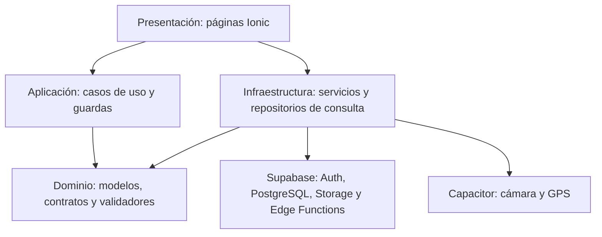
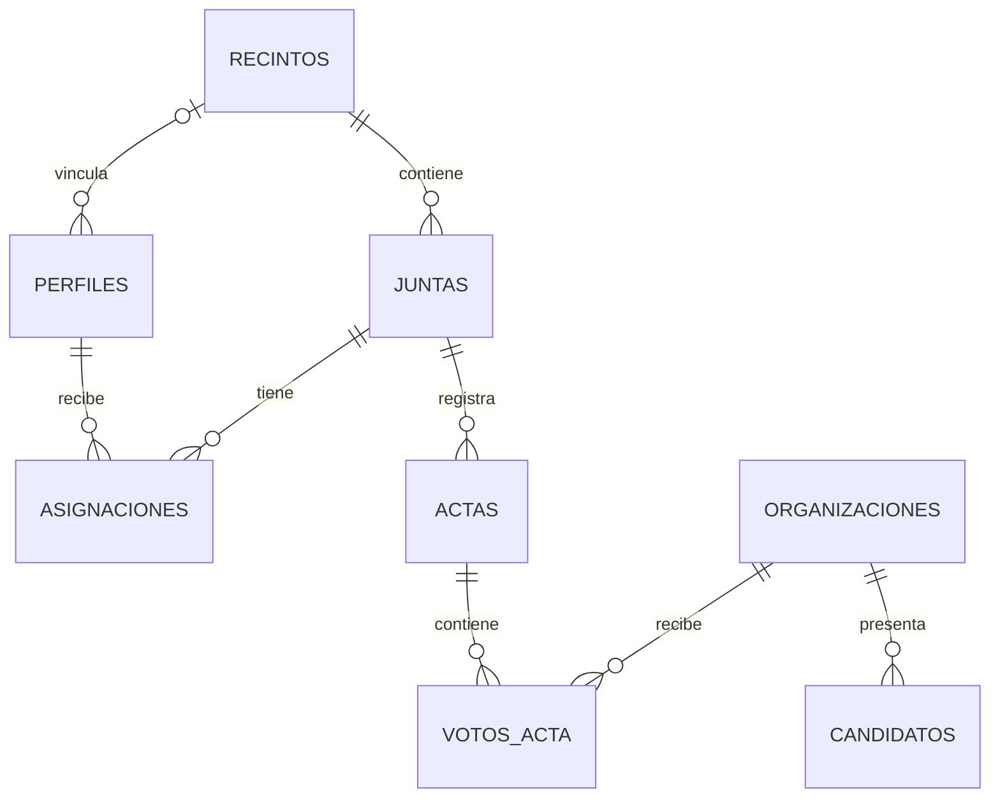

# Control Electoral

Aplicación móvil para gestionar y supervisar el registro de resultados electorales en juntas receptoras del voto (JRV). Proyecto individual del examen práctico de Desarrollo de Aplicaciones Móviles.

## 1. Objetivo

Centralizar el registro de actas electorales, gestionar responsables por recinto y junta, capturar evidencias fotográficas y coordenadas GPS, y consultar resultados consolidados.

## 2. Funcionalidades y roles

| Rol | Funcionalidades |
|---|---|
| Coordinador provincial | Gestión de recintos, juntas, coordinadores, organizaciones y candidatos; consulta de avance, evidencias y resultados. |
| Coordinador de recinto | Gestión de veedores, asignación y reasignación de juntas, consulta de estados y corrección de actas y evidencias de su recinto. |
| Veedor | Consulta de juntas asignadas, registro de votos de alcaldía y prefectura, validación de totales y captura de evidencias. |

No existe autorregistro. Las cuentas se crean jerárquicamente. El acceso utiliza cédula y contraseña, cambio obligatorio de contraseña inicial y recuperación mediante código enviado por correo.

## 3. Tecnologías

| Tecnología | Uso |
|---|---|
| Ionic Angular 9 | Interfaz móvil |
| Angular 22.2.6 (standalone) | Componentes, rutas, Signals y formularios reactivos |
| TypeScript 6 | Desarrollo de la aplicación |
| Capacitor 8 | Integración con Android, cámara y geolocalización |
| Supabase | PostgreSQL, Auth, Storage, RLS y Edge Functions |
| Brevo | Correo de bienvenida y recuperación de contraseña |
| Vitest | Pruebas unitarias |
| ESLint | Análisis estático |
| Git y GitHub | Control de versiones |

## 4. Instalación y ejecución

### Requisitos

- Node.js (entorno utilizado: 24.21.0) y npm (11.19.0).
- Ionic CLI (entorno utilizado: 7.2.1).
- Android Studio y JDK compatible con la configuración Gradle del proyecto, para compilar Android.
- Acceso autorizado a un proyecto Supabase configurado para Control Electoral.

```bash
git clone https://github.com/josselynreyes-ux/Examen01_DesarrolloMovil.git
cd Examen01_DesarrolloMovil
npm ci
```

Seleccionar la rama que contiene la versión final si no coincide con la rama predeterminada del repositorio.

Si Ionic CLI no está instalado:

```bash
npm install -g @ionic/cli
```

### Configuración de Supabase

Configurar `src/environments/environment.ts` y `src/environments/environment.prod.ts` con la URL y la clave pública (publishable o anon) del proyecto correspondiente. Ejemplo para desarrollo:

```typescript
export const environment = {
  production: false,
  supabaseUrl: 'https://TU_PROYECTO.supabase.co',
  supabaseKey: 'TU_CLAVE_PUBLICA'
};
```

En el archivo de producción, utilizar `production: true`.

Nunca incluir claves `service_role`, claves secretas, credenciales SMTP ni claves privadas de Brevo en el código cliente o repositorio.

El backend debe contar con las ocho tablas del modelo de datos, funciones SQL, políticas RLS, bucket privado `actas-electorales` y Edge Functions `login-cedula` y `crear-usuario`. La recuperación utiliza el servicio de correo de Supabase configurado con Brevo SMTP. El correo de bienvenida utiliza la API de Brevo desde el backend, con los secretos `BREVO_API_KEY`, `BREVO_SENDER_EMAIL` y `BREVO_SENDER_NAME` configurados en el servidor.

La aplicación depende del backend configurado. Clonar el repositorio no crea automáticamente una instancia nueva de Supabase ni sus datos iniciales. No se incluye un respaldo completo del backend.

### Ejecución web

```bash
ionic serve
```

### Compilación Android

La plataforma Android ya forma parte del proyecto.

```bash
ionic build
npx cap sync android
npx cap open android
```

Desde Android Studio se puede generar el APK de depuración. Alternativamente, en PowerShell, con Java correctamente configurado:

```powershell
.\android\gradlew.bat -p android assembleDebug
```

Ubicación del APK generado:

```text
android/app/build/outputs/apk/debug/app-debug.apk
```

## 5. Arquitectura Clean-lite

Se separan las responsabilidades de presentación, aplicación, dominio e infraestructura. Las páginas gestionan la interacción y el estado visual; los casos de uso coordinan operaciones de negocio; el dominio contiene modelos, contratos y validaciones; la infraestructura implementa el acceso a Supabase y los servicios nativos.



Estructura principal:

```text
src/app/
├── core/
│   ├── application/
│   │   ├── guards/
│   │   └── use-cases/
│   ├── domain/
│   │   ├── models/
│   │   ├── repositories/
│   │   └── validators/
│   └── infrastructure/
│       ├── capacitor/
│       ├── repositories/
│       └── supabase/
├── presentation/
│   ├── auth/
│   ├── provincial/
│   ├── recinto/
│   └── veedor/
└── app.routes.ts
```

Casos de uso principales: registrar acta, corregir acta, crear usuario y asignar veedor. Se emplean Signals para el estado de las pantallas, formularios reactivos para la captura y validación de datos y guardas de Angular Router para controlar la navegación por rol. Clean-lite es una separación pragmática: las consultas pueden utilizar repositorios concretos desde presentación.

## 6. Modelo de datos

| Tabla | Responsabilidad |
|---|---|
| `perfiles` | Identidad, cédula, contacto, rol, recinto y cambio de contraseña pendiente. |
| `recintos` | Provincia, cantón, parroquia, nombre, cantidad de JRV y ubicación. |
| `juntas` | Juntas receptoras del voto y estado de registro. |
| `asignaciones` | Relación entre veedores y juntas, con historial de asignaciones. |
| `organizaciones` | Organizaciones políticas y siglas. |
| `candidatos` | Candidaturas por organización y dignidad. |
| `actas` | Resultados por junta y dignidad, totales, estado, fotografía y GPS. |
| `votos_acta` | Cantidad de votos por organización en cada acta. |



Se utilizan claves primarias UUID, claves foráneas y restricciones de unicidad para evitar duplicados de actas por junta y dignidad, votos por organización y asignaciones activas incompatibles.

## 7. Seguridad

- Autenticación mediante Supabase Auth y Edge Function `login-cedula`.
- Creación jerárquica de cuentas mediante `crear-usuario`.
- Guardas de navegación por rol y estado de cambio de contraseña.
- Políticas RLS en las tablas para limitar el acceso según rol y pertenencia.
- Funciones SQL para registrar y corregir actas, comprobar permisos y guardar evidencias.
- Bucket privado `actas-electorales`, imágenes JPEG de hasta 5 MB y acceso mediante URLs firmadas.
- Claves administrativas y secretos de correo únicamente en el backend.

Las guardas de interfaz complementan, pero no sustituyen, los controles del servidor.

## 8. Cámara, GPS y validaciones

Capacitor permite capturar fotografías y obtener coordenadas GPS. Se gestionan permisos y errores. La nitidez se estima mediante la varianza del Laplaciano, con umbral inicial de 100; este indicador no garantiza por sí solo la legibilidad del acta. La ubicación utiliza un tiempo de espera de 20 segundos.

La validación de cédula ecuatoriana se aplica al crear cuentas. Los votos deben ser enteros no negativos y la suma de votos por organización, nulos y blancos debe coincidir con el total de sufragantes. La lógica de registro y corrección también se valida en el backend.

## 9. Pruebas

```bash
npm run test:unit
npx eslint "src/app/**/*.ts"
```

Resultados registrados durante el desarrollo:

| Prueba unitaria | Aprobadas |
|---|---:|
| Validación de cédula | 8 |
| Validación de votos | 7 |
| Validación de nitidez | 6 |
| Componente principal | 1 |
| Página inicial | 1 |
| **Total** | **23** |

Se registraron 5 archivos de pruebas aprobados y 23 pruebas exitosas. El comando ESLint indicado no reportó errores. Se realizaron pruebas funcionales de los tres roles, recuperación de contraseña, cámara, GPS y corrección de actas. También se comprobó mediante consultas con roles simulados que un veedor no puede consultar juntas ajenas ni registrar actas en una junta no autorizada.

No se afirma una ejecución exitosa de toda la suite E2E. La comprobación negativa de acceso a fotografías ajenas requiere una evidencia adicional de otro recinto o junta.

Documentación complementaria: [Pruebas](docs/pruebas/).

## 10. Credenciales de demostración

Identificadores de las cuentas de prueba no sensibles:

| Rol | Cédula de demostración |
|---|---|
| Coordinador de recinto | `0000000001` |
| Veedor | `0000000002` |

El acceso provincial y las contraseñas vigentes de demostración se facilitan a los docentes por un canal privado. Los identificadores ficticios corresponden a cuentas de prueba existentes, no a ejemplos de cédulas ecuatorianas válidas para el formulario de creación de usuarios.

## 11. Alcance y limitaciones

La implementación contempla los módulos correspondientes a R1–R9 del examen. La captura de evidencias se realiza después del registro de votos; debe completarse para cada acta. No se implementó la sincronización offline de R10, que es opcional. Se requiere conexión al backend para las operaciones remotas.

El cambio obligatorio de contraseña y los permisos del servidor requieren revisión continua; las pruebas realizadas no constituyen una auditoría exhaustiva de seguridad.

## 12. Decisiones arquitectónicas y uso de IA

- [Registros de decisiones arquitectónicas (ADR)](docs/adr/).
- [Anexo de uso de inteligencia artificial](docs/anexo-ia.md).

## 13. Demostración

[Video demostrativo de Control Electoral](https://youtu.be/nPRdLNrNxls?si=QgxsH-znkpcd0Jca)

## 14. Autora

**Josselyn Mabel Reyes Parrales**  
Escuela Politécnica Nacional — Escuela de Formación de Tecnólogos  
Carrera de Desarrollo de Software  
Desarrollo de Aplicaciones Móviles — Grupo 4  
Noviembre de 2026

## 15. Descarga del APK 

La aplicación Control Electoral está disponible para dispositivos Android.

**Versión:** 1.0.0

[Descargar APK de Control Electoral](https://github.com/josselynreyes-ux/Examen01_DesarrolloMovil/releases/latest)

### Instrucciones de instalación

1. Descargar el archivo APK desde GitHub Releases.
2. Transferir el archivo al dispositivo Android.
3. Autorizar la instalación desde fuentes externas, si el dispositivo lo solicita.
4. Instalar y abrir la aplicación.
5. Iniciar sesión con las credenciales de demostración.

La aplicación requiere conexión a Internet.
